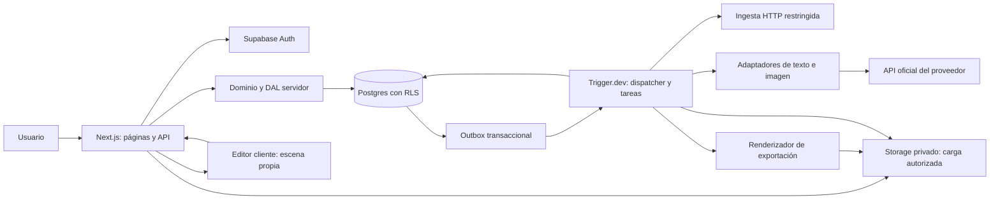

# Arquitectura propuesta — plataforma SaaS de marketing creativo

Estado: propuesta para aprobación; **no implementada**. Fecha: 2026-10-26, America/Mexico_City.
Base: lectura completa de [Recon](recon.md) y sus 73 filas de [funcionalidades](features.csv), aprobados por el usuario. Esta fase autoriza documentos y su publicación, no código, servicios, Design o Build. Las referencias a Holo explican necesidades funcionales; no describen ni copian su arquitectura interna.

Documentos complementarios: [modelo de datos](data-model.md), [API y trabajos](api-and-jobs.md), [IA, costes y seguridad](ai-costs-security.md). Las decisiones expresadas como límites iniciales son nuestras, no límites confirmados de un proveedor.

## 1. Resultado y alcance

**Decisión: monolito modular TypeScript**, Next.js App Router, Tailwind, Supabase (Postgres/Auth/Storage), tareas en Trigger.dev y OpenAI como proveedor inicial seleccionado para texto e imagen. React-Konva para composición en navegador; exportación autoritativa del documento en un worker con renderizador compartido. Un repositorio y una base de datos; web y tareas despliegan el mismo dominio de negocio en runtimes distintos. Sin microservicios, Kubernetes, base vectorial o agente autónomo.

La elección de proveedores es arquitectónica. Modelos concretos, versiones, tarifas, regiones y límites deben confirmarse antes de habilitar llamadas. No se contrataron servicios, configuraron cuentas ni hicieron pruebas con APIs pagadas.

### Versión 1: un circuito completo

1. Usuario autenticado introduce una URL de empresa, o completa datos manualmente si la extracción falla.
2. Importación acotada propone Brand DNA con evidencias; el usuario corrige y aprueba una revisión.
3. Se proponen productos importados y se administran manualmente nombres, descripciones e imágenes; nada detectado se considera automáticamente correcto.
4. Un brief de producto genera tres conceptos editables (decisión propia, no cantidad fija atribuida a Holo).
5. El usuario elige concepto y solicita una imagen real, con referencia de producto y coste/cuota autorizados.
6. Añade texto, mueve/cambia tamaño de capas, ajusta encuadre, colores y composición.
7. Guarda versiones en biblioteca privada con contexto de generación y previsualización.
8. Exporta un anuncio PNG desde una revisión exacta, sin volver a pagar una generación de IA.

Composición inicial: lienzo cuadrado 1080×1080 y vertical 1080×1920; fondo raster generado, imágenes autorizadas, texto y formas simples. Estos tamaños son especificaciones nuestras del documento de edición: **no se afirma que un modelo los genere nativamente**. Adaptar/cortar la imagen fuente de forma explícita, sin deformar el producto. Fuentes licenciadas y catálogo reducido; edición por capas, no un clon de Photoshop.

Fuera de V1: chat general, swipe obligatorio, galerías de terceros, marketplace, pagos/suscripciones automatizados, invitaciones de equipo, video/UGC, redes, email/SEO, gasto publicitario y publicación autónoma. Se conserva multitenencia desde el principio; el alta crea un workspace con un owner y una marca inicial. No se fija artificialmente el SaaS a un único cliente. No se implementa aún UI de múltiples marcas/equipos.

## 2. Selección tecnológica y alternativas

| Capa | Elección | Justificación y coste operativo | Alternativas y decisión |
| --- | --- | --- | --- |
| Web y backend | Next.js App Router + TypeScript estricto, runtime Node | Una app comparte tipos, validación y dominio; renderizado inicial en servidor, editor aislado en cliente. API propia mediante Route Handlers, sin backend adicional | SPA + backend separado duplica operación sin necesidad inicial; framework Python solo se justificaría por workloads propios de ML futuros |
| Estilos | Tailwind; componentes semánticos propios | Convenciones consistentes y escaso CSS artesanal; estilos no sustituyen accesibilidad | CSS Modules viable; se descarta mezclar sistemas. Tokens e identidad quedan para Design |
| Datos | Postgres gestionado en Supabase | Relaciones, transacciones, restricciones, JSONB y RLS en un servicio; sin otra base o caché inicialmente | Neon + Auth/Storage separados es viable pero añade contratos y configuración; SQLite no es elección para el SaaS concurrente |
| Acceso a datos | supabase-js en DAL servidor + funciones transaccionales de Postgres | Reutiliza JWT y RLS; sin ORM duplicado. Migrations versionadas como futura fuente de verdad | Drizzle ofrece tipos/SQL y se evaluó; no añadirlo inicialmente para no abrir dos rutas de acceso con políticas distintas. Prisma añade otra abstracción innecesaria aquí |
| Auth | Supabase Auth SSR; email+contraseña verificada al inicio | Menos integración; sesión validada en servidor. SMTP transaccional de producción es dependencia a verificar | Auth.js requiere ensamblar identidad y RLS; Clerk es otro proveedor y coste. Google OAuth posterior, no requisito de V1 |
| Archivos | Supabase Storage, buckets privados | Autorización integrada y menos proveedores; DB solo guarda metadatos | R2/S3 son opciones si mediciones de salida/volumen justifican mover blobs; no declarar ahorro sin tarifas |
| Trabajos | Trigger.dev gestionado | SDK TypeScript, colas/concurrencia, reintentos y observabilidad documentados; evita usar una request web larga como worker | Inngest viable; Postgres queue + worker propio reduce un proveedor pero traslada operación/leases. Vercel Cron solo dispara, no sustituye cola durable |
| Texto e imagen | OpenAI, con adaptadores finitos y versión/configuración registrada por solicitud | Una relación de proveedor inicialmente; generación y edición de imagen documentadas, errores explícitos y contexto controlado | Gemini es alternativa real de imagen/edición; no activar fallback silencioso. Modelos propios aumentan cómputo, licencias y operación; no V1 |
| Editor | React-Konva, documento de escena propio versionado | Integración React y primitivas de lienzo; construimos solo capas necesarias. No serializar estado opaco de librería como contrato permanente | Fabric.js viable; SDK comercial de editor exigiría presupuesto/licencia; no es necesario para el alcance mínimo |
| Exportación | Renderizador de escena compartido sobre Canvas; worker Node con Chromium/Playwright fijado | Mismo documento, fuentes y orden de capas; PNG persistido, verificable y reproducible sin depender de pestaña abierta | Canvas exclusivamente cliente facilita prototipo pero pierde fiabilidad y exportación recuperable; no es salida autoritativa |
| Hosting propuesto | Vercel para Next.js; Trigger.dev para tareas; Supabase en región próxima | Encaja con stack sin operar máquinas web; pagar por uso/plan según contrato. Workers largos fuera del hosting web | Render/Fly son alternativas si límites o coste medido no encajan. No depender de duración ilimitada en funciones |
| Validación futura | Zod en fronteras, Vitest para dominio y Playwright para recorrido | Mismo contrato para API/jobs/documento; pruebas de aislamiento y render esenciales | No generar tests ni instalar herramientas en esta fase |

**Versiones:** al comenzar Build, elegir releases estables compatibles, fijarlas exactamente en lockfile y documentar runtime Node LTS soportado por hosting/worker. No usar etiquetas `latest` para modelos ni procesos productivos. No se inventa ahora una matriz de compatibilidad de versiones no probada. Chromium, librerías de imagen y soporte del runtime de tareas son un gate técnico antes de comprometer el despliegue.

## 3. Diagrama de responsabilidades

Outbox no significa que Postgres envíe automáticamente nada: un dispatcher lee pendientes y dispara tareas; la confirmación queda en DB. La API puede dar un aviso rápido al dispatcher tras commit, pero la recuperación no depende de que ese aviso llegue. DB es la autoridad de trabajos/quotas/versiones, no la memoria del navegador ni el estado del proveedor de tareas.

## 4. Módulos y reglas de dependencia

| Módulo lógico | Responsabilidad | Frontera |
| --- | --- | --- |
| Identity / Tenancy | Identidad, workspace y autorización | Devuelve contexto verificado; nunca confiar en workspace del cuerpo |
| Brands / Imports | Ingesta limitada, evidencia y revisión de perfil | Texto externo es datos; no ejecuta instrucciones ni herramientas propuestas por la web |
| Catalogue | Productos, estado de revisión y vínculos con imágenes | Toda imagen pertenece a la misma marca/workspace |
| Creative planning | Brief y conceptos con contratos estructurados | Referencia revisiones aprobadas, no perfil mutable sin snapshot |
| Generation | Solicitudes, estado, proveedor y outputs | Sin acceso a publicar o modificar cuentas externas |
| Compositions | Documento de escena, cambios y versiones | Sin secretos ni lógica de proveedores dentro de componentes |
| Library / Export | Consulta de creativos y render recuperable | Solo exporta activos listos/autorizados |
| Platform | Jobs/outbox, cuotas, auditoría y storage | Servicios específicos; evitar un módulo genérico que contenga todo el negocio |

Organización futura por funcionalidad, no una carpeta gigante de utilidades. Componentes compartidos limitados a formularios, selección de activo, estados de trabajo, controles de composición y biblioteca; lógica de cada caso en servicios de aplicación. Dominio no importa Next.js, SDKs de IA o controles de canvas. Adaptadores dependen de contratos de dominio, no al revés. Server Components leen DTOs mínimos desde DAL; Route Handlers ejecutan mutaciones; la UI no accede directamente a tablas de negocio. Subida a Storage mediante autorización temporal es excepción controlada.

No se diseña una biblioteca universal de proveedores ni un bus de plugins. Dos contratos iniciales bastan: generar datos textuales estructurados y generar/editar una imagen desde referencias. Worker y web comparten esos servicios sin llamadas HTTP a su propia API para cada operación.

## 5. Editor, composición y exportación

Documento de escena v1: tamaño, fondo y lista ordenada de capas con ID, tipo imagen/texto/forma, geometría, rotación, opacidad y propiedades permitidas. Imágenes referencian IDs internos de assets, no URLs arbitrarias. Texto conserva contenido, fuente de catálogo, tamaño, color, alineación, interlineado y caja. Límites iniciales propuestos: 30 capas, 2.000 caracteres totales y 4 millones de píxeles por exportación. Validar límites en frontend **y** servidor; ajustar solo después de medir.

El producto puede representarse como recorte fotográfico propio sobre fondo generado para preservar su apariencia; edición generativa con referencia sigue disponible cuando el proveedor la soporte. No se promete segmentación perfecta: si se necesita recorte, ofrecer imagen transparente aportada por el usuario o un paso manual, no un servicio oculto inventado.

Guardar crea revisión inmutable y actualiza el puntero actual mediante versión esperada; concurrencia devuelve conflicto y ofrece recargar/duplicar. Undo/redo local limitado; no colaboración en tiempo real. La generación fija snapshot de DNA, producto, brief y configuración; cambiar el DNA después no modifica creaciones históricas. Cada exportación referencia un `creative_revision_id` exacto, versión de renderizador y hashes de activos/fuentes. Cambiar una capa requiere nueva revisión/exportación, no sobrescribir el anuncio anterior.

Antes de capturar, el worker espera fuentes e imágenes, comprueba ausencia de recursos fallidos y renderiza a tamaño exacto; no acepta HTML, JS o fuentes remotas del usuario. El renderer usa el mismo modelo y motor de canvas, con adaptadores cliente/worker pequeños. La salida autoritativa es el PNG guardado. Previsualización cliente no prueba equivalencia binaria entre navegadores; usar pruebas visuales tolerantes y entorno de exportación fijado.

## 6. Autenticación y multitenencia

Una identidad de Supabase puede pertenecer a varios workspaces; V1 crea uno con rol owner y no ofrece invitaciones. Todas las tablas de negocio pertenecen a workspace, y las específicas de marca también a brand. Validación de JWT en servidor según documentación SSR; no basta leer una cookie o confiar en `getSession`. Revalidar usuario y membership para borrado de workspace y operaciones sensibles. Cookies configuradas según SDK SSR oficial, CSRF/Origin en mutaciones, sesión fuera de caches compartidas.

La DAL autoriza por petición y minimiza respuesta; RLS restringe toda lectura de negocio con JWT. Funciones transaccionales impiden que el cliente cambie saldo, roles, snapshots aprobados o resultados de jobs. Claves de servicio solo en entornos servidor autorizados. Los workers trabajan con IDs persistidos y autorización vigente, no con una copia de permisos enviada por navegador. Detalle de políticas en `data-model.md`.

## 7. Escala y operación

Inicio: una región, una base, consultas paginadas por cursor, índices compuestos por tenant, polling de jobs; sin Realtime ni Redis. Concurrencia inicial configurable y conservadora (objetivo: 1 generación de imagen activa por workspace y 5 globales; no son cuotas del proveedor). Dispatcher/worker deben adquirir permisos de concurrencia persistidos; un límite en UI o SDK no basta.

Observar cola, edad del trabajo más antiguo, p50/p95 por etapa, errores por proveedor, coste por resultado aceptado, reservas pendientes, fallos de exportación, almacenamiento y salida. No establecer SLA o número de usuarios soportados sin pruebas. Escalar primero workers/concurrencia dentro del presupuesto; después optimizar consultas y retención. Particionar/mover archivos o separar servicios solo ante métricas, no anticipadamente.

Backups y restore de DB y objetos se verifican por separado: un backup de Postgres no contiene necesariamente los blobs. Objetivos propuestos previos a producción: RPO 24 h y RTO 1 día para beta; no garantizados por el plan actual. Confirmar PITR, frecuencia, retención y restauración en contrato. Preproducción y producción usan proyectos/credenciales separados; ningún recurso se crea en esta fase.

## 8. Trazabilidad del alcance y orden futuro de construcción

Las ocho necesidades del usuario corresponden a F01/F02 de Recon más composición/exportación propias; F03/F04 (video), F05 (campañas), F06 (social), F07 (email) y F08 (SEO) quedan diferidas. La biblioteca sí entra en V1 aunque Recon la clasificara por capacidades separadas. No se cambian `features.csv` ni sus `clone=no`: esta fase no implementa nada.

| Hito futuro | Entrega vertical y superficies de Recon | Datos principales | Contratos / criterio de aceptación |
| --- | --- | --- | --- |
| B1: primer circuito real | S03/S04/S07/S08/S11/S12/S21/S22; versión mínima de los ocho pasos | Workspace, marca/revisión, un producto/asset, conceptos, job, creativo/revisión, exportación | Una URL real autorizada produce borrador editable; aprobación; imagen real; texto propio editado y PNG recuperable. IA mock solo para desarrollo y siempre rotulada; no acepta MVP |
| B2: consistencia y aislamiento | Mismas superficies, manejo completo de estados | Políticas, snapshots, outbox, usage y auditoría | Pruebas negativas entre tenants, duplicados, caídas, SSRF y cuotas; no pérdida silenciosa de trabajos |
| B3: catálogo/editor/biblioteca completos | S08/S21/S22 | Múltiples productos e imágenes, filtros, revisiones | Altas/edición/archivado; fuentes/formatos; conflictos; biblioteca paginada y exportación exacta |
| B4: beta controlada | S23 mínimo, operación | Retención, métricas, backup y cuenta | Presupuesto, carga acotada, errores operables, borrado/restore documentado y revisión de derechos |

B1 construye las tablas necesarias progresivamente; no se exige acabar primero todo el backend. B2/B3 completan los 15 must del CSV; el mapa preciso de cada fila está en `api-and-jobs.md`. No se ejecuta ningún hito ahora. Design, Build y despliegue requieren una autorización posterior.

## 9. Extensión futura sin construirla

Video/UGC: nuevo tipo de job y metadatos de asset/revisión, proveedor específico, guion, duración, moderación y consentimiento de imagen/voz. Mantener contratos versionados; no introducir columnas vacías y tablas de actores antes de necesitarlas. No asumir que el modelo de imagen genera video ni que la misma API cubre UGC.

Redes: futuro módulo de conexiones OAuth con vault/rotación, scopes, aprobaciones de plataforma, scheduling idempotente y auditoría de consentimiento. Publicar es una acción distinta de exportar y necesita autorización; nunca hereda implícitamente permisos de generación. Automatización: políticas por canal y acciones aprobadas, límites de frecuencia/gasto y revocación; desactivar debe definir qué ocurre con trabajos ya programados. No existen aún endpoints de redes ni tablas de tokens.

SaaS comercial: cuotas administrativas en beta, sin créditos vendibles, facturación ni pagos implementados. Integración de billing posterior podrá cambiar entitlements por workspace mediante eventos autenticados e idempotentes; no modelar una economía de créditos antes de medir coste real y soporte. La publicación de estos documentos no autoriza gastos.

## 10. Decisiones y gates antes de Build

Decisiones seleccionadas: stack de §2; DB relacional de 16 tablas propias; REST de 32 operaciones descritas; trabajos recuperables; escena propia y PNG server-side. Son especificaciones revisables, no capacidades verificadas de una aplicación ya construida.

Gates: modelos disponibles para nuestra cuenta y términos de datos; precio verificable y límites de gasto; aceptación de referencias y fidelidad; compatibilidad de worker/Chromium/fonts; conectividad SSRF resistente a DNS rebinding; RLS y funciones de cuotas probadas; SMTP y entrega; región/retención/backup. Si un gate falla, ajustar la decisión con evidencia y pedir aprobación de un cambio material; no ocultarlo con mocks o fallback.

Fuentes técnicas, coste y límites de evidencia están registrados en `ai-costs-security.md`. Pendiente aprobación de arquitectura. No se avanza automáticamente a Design ni Build.
