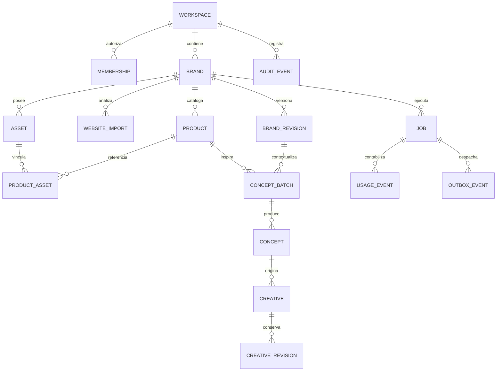

# Modelo relacional y políticas de acceso

Propuesta de arquitectura, 2026-10-26. Complementa [architecture.md](architecture.md). **Contrato documental sin SQL ejecutable, migrations o servicios configurados**, respetando la instrucción de no escribir código. El SQL que sugiere la skill se pospone hasta Build autorizado. No es el esquema de Holo.

## 1. Convenciones obligatorias

16 tablas propias; `auth.users` y `storage.objects` son gestionadas por Supabase y no cuentan como tablas nuestras. Cada tabla tiene `id` UUID generado por servidor, `created_at` y `updated_at` timestamptz UTC. En registros inmutables, updated_at permanece igual a created_at; correcciones se añaden como nuevos registros. Cada tabla salvo workspaces incluye `workspace_id` obligatorio; workspaces es el tenant raíz y tiene `owner_user_id`. Cada tabla de marca lleva `brand_id` obligatorio. El actor se deriva de sesión, no del JSON del cliente.

Las columnas de referencia son UUID con FK, índice y regla explícita de borrado. Los nombres descritos son campos propuestos, no código SQL. Texto de estado se valida con CHECK; importes comerciales futuros en céntimos enteros y moneda ISO. Costes internos de API se registran en **microunidades monetarias enteras** para no redondear cada llamada subcéntimo; una moneda por ledger y presupuesto, inicialmente USD si el proveedor factura así. No mezclar monedas sin tipo de cambio registrado. Números monetarios nunca float.

Todos los recursos de marca disponen de clave única `(workspace_id, brand_id, id)` cuando son destino de FK compuesta. Productos/assets/conceptos/revisiones conservan este contexto. FKs compuestas, no solo IDs globales, impiden referenciar un producto o asset de otra marca/workspace incluso si el UUID es conocido. El puntero a una revisión y su creativo/perfil también se valida como relación compuesta: no basta con que la revisión pertenezca al mismo tenant.

## 2. Tablas y campos

| # | Tabla | Datos propuestos además de convenciones comunes | Restricciones e índices |
| --- | --- | --- | --- |
| 1 | workspaces | owner_user_id; bootstrap_key/request_hash; name; status; budget_currency; period_start/end; period_limit_micros; reserved_micros; settled_micros; revision | Owner FK auth.users RESTRICT; status active/deleting/deleted; importes no negativos; end > start. Índices owner y status; UNIQUE parcial de owner para workspace active/deleting en V1; bootstrap_key persistida para reintentos. Cambio de periodo bajo lock sin perder reservas de periodos anteriores |
| 2 | memberships | user_id; role; status | FK workspace CASCADE, user auth.users RESTRICT; UNIQUE workspace/user; roles owner/member; active/revoked. Índice user/status/workspace; un único owner activo, coherente con workspace.owner_user_id |
| 3 | brands | name; website_url opcional; current_revision_id opcional; archived_at; revision | FK workspace CASCADE; FK a revisión de SU perfil RESTRICT cuando no nula. Índice workspace/archived_at/created_at/id; marca archivada no acepta nuevos jobs |
| 4 | brand_revisions | brand_id; revision_number; profile_document; source_import_id opcional; approval_status; approved_by/at; created_by | FK brand CASCADE; source_import compuesto RESTRICT; actores auth.users RESTRICT. UNIQUE brand/revision_number; draft/approved/rejected; aprobado exige actor/fecha. Perfil inmutable tras aprobación. Índice workspace/brand/created_at/id |
| 5 | website_imports | brand_id; requested_url; normalized_url; mode; source_pages; extraction_document; content_hash; extractor_version; status; error_code | FK brand CASCADE; mode company/product; pending/running/needs_review/completed/failed/cancelled; fuente contiene URL/fecha/hash/evidencia por campo, sin scripts. Índice workspace/brand/created_at/id y status/updated_at |
| 6 | products | brand_id; name; description; source_url opcional; status; revision | FK brand CASCADE; draft/active/archived; origen inferido requiere revisión; revisión optimista; índice workspace/brand/status/name/id. No exigir SKU o precio para servicios |
| 7 | product_assets | brand_id; product_id; asset_id; position; is_primary | FK producto CASCADE; asset RESTRICT, ambas compuestas de la misma marca; UNIQUE producto/asset y producto/position; máximo un primary por producto (índice único parcial); índice asset. No reutilización entre marcas implícita |
| 8 | assets | brand_id; kind; bucket; object_key; checksum; mime_type; byte_size; width/height; status; source_kind; rights_document; created_by opcional; deleted_at | FK brand CASCADE y actor RESTRICT; imagen o exportación en V1; pending/quarantined/ready/failed/deleting/deleted; UNIQUE bucket/object_key; dimensiones y tamaño positivos al ready; índice workspace/brand/status/created_at/id. Sin URLs firmadas persistidas |
| 9 | concept_batches | brand_id; brand_revision_id; product_id; product_snapshot; brief; prompt_template_version; status | FKs brand CASCADE, revisión aprobada y producto compuestos RESTRICT; draft/queued/running/completed/failed/cancelled. Brief/snapshot inmutables tras submit; índice workspace/brand/created_at/id y producto |
| 10 | concepts | brand_id; batch_id; ordinal; angle; headline; body; cta; visual_direction; status; revision | FK batch CASCADE, brand CASCADE; UNIQUE batch/ordinal; draft/selected/archived. Ediciones solo antes del job o nueva revisión lógica; índice workspace/brand/status/created_at/id |
| 11 | creatives | brand_id; concept_id opcional; title; current_revision_id opcional; status; is_favorite; revision | FKs brand CASCADE, concepto compuesto RESTRICT; FK current_revision debe ser del mismo creativo, RESTRICT; draft/saved/archived; índice workspace/brand/status/updated_at/id y brand/is_favorite/updated_at/id |
| 12 | creative_revisions | brand_id; creative_id; revision_number; scene_version; scene_document; input_snapshot; referenced_asset_ids; renderer_version; created_by | FK creativo CASCADE y actor RESTRICT; UNIQUE creativo/revision_number. Inmutables. Lista de activos validada transaccionalmente contra misma marca y ready. Índice workspace/brand/creative/created_at/id |
| 13 | jobs | brand_id; requested_by; kind; input_document; snapshot_hash; idempotency_key; request_hash; status; step; provider/model; provider_request_id opcional; config_version; attempt; lease_until; lease_token; deadline; reservation_micros; budget_period_start; output_document; error_code; cancel_requested_at | FK brand CASCADE, actor RESTRICT; UNIQUE workspace/kind/idempotency_key. Estados y tipos cerrados en api-and-jobs.md. Índices status/next_run_at (campo de scheduling), workspace/status/created_at/id, brand/created_at/id, provider_request_id. Resultado y reserva solo worker/función autorizada |
| 14 | usage_events | brand_id; job_id; event_key; event_type; currency; amount_micros; price_version; usage_document; provider_request_id opcional; budget_period_start | FKs brand CASCADE, job compuesto RESTRICT; UNIQUE job/event_key. Append-only: reserve/settle/release/adjustment; cantidad no negativa; tipo determina efecto, nunca saldo editable por usuario. Índices workspace/budget_period_start/created_at/id y job |
| 15 | audit_events | actor_user_id opcional; brand_id opcional; event_type; entity_type/id; correlation_id; redacted_metadata | Workspace CASCADE; brand compuesto RESTRICT si presente; actor auth.users RESTRICT hasta anonimización. Append-only. Índices workspace/created_at/id, actor, brand, correlation_id. Sin prompts completos, cookies, tokens ni URLs firmadas |
| 16 | outbox_events | brand_id; job_id; event_key; event_type; status; next_attempt_at; attempts; lease_until; lease_token; dispatched_at | FKs brand CASCADE, job compuesto RESTRICT; UNIQUE event_key; pending/leased/dispatched/dead. Índices status/next_attempt_at e índice job. Payload solo IDs, nunca secretos |

`next_run_at` en jobs y campos técnicos como attempts son explícitos aunque se reutilicen entre etapas. Cantidades máximas, formato de documentos y listas se validan mediante contrato versionado en servidor; CHECK solo para invariantes sencillas. JSONB no sustituye FKs: los IDs de JSON se comprueban antes de persistir, y el worker revalida antes de leer bytes. Un cliente no puede escribir escena ilimitada o apuntar a un objeto sin autorización.

## 3. Relaciones y ciclos de vida

Diagramas muestran relaciones funcionales, no migraciones ni todas las FKs. Campos opcionales explican por qué un creativo manual puede no tener concepto. Exportación se registra como asset de salida en job.output_document junto a `creative_revision_id`; no hace falta otra tabla inicialmente.

Ciclos brand/current_revision y creative/current_revision: crear raíz con puntero nulo; insertar revisión con FK a raíz; actualizar puntero dentro de una transacción. Borrado duro requiere primero limpiar punteros para no crear ciclos de restricción. `source_import_id` se conserva para trazabilidad; no purgar su fila mientras existan revisiones que lo referencien, aunque se elimine HTML bruto. Los punteros de JSON solo se purgan en proceso de borrado completo cuando ya no hay consumidores.

Producto usado se archiva; no se borra físicamente dejando conceptos/jobs rotos. Asset referenciado se archiva/oculta, pero sus bytes no se purgan mientras una revisión retenida necesite exportarlos, salvo solicitud de eliminación completa del propietario. No sobrescribir object_key: nuevo contenido es un nuevo asset con checksum.

## 4. RLS, grants y separación de privilegios

RLS habilitada en todas las tablas expuestas. Las políticas usan identidad verificada y membership activa del workspace; no un workspace en JWT sin consulta de autorización actual ni metadata editable por usuario. El acceso miembro a una marca es acceso de workspace en V1; si se añade asignación específica por marca, se crea una relación explícita y se endurece la política antes de ofrecer esa función.

| Grupo | Lectura con sesión | Escritura con sesión | Acceso privilegiado |
| --- | --- | --- | --- |
| workspaces/memberships | Solo workspace propio | Sin INSERT/UPDATE/DELETE directo; funciones de bootstrap/gestión controladas | Creación atómica owner+membership; transferencia no V1; no escalada de rol |
| brands/products/concepts/creatives | Tenant activo, marca no eliminada | DAL y RPC con validación, contexto y versión; grants mínimos, no privilegios de job | Worker solo crea resultados de un job autorizado |
| brand_revisions/creative_revisions | Tenant y marca propios | Creación/confirmación mediante funciones que validan punteros y snapshots | Aprobadas e históricas inmutables |
| assets/product_assets | Metadatos del tenant | URL autorizada solo para ruta pending; finalize valida contenido; asociación transaccional | Worker crea outputs y cambia estado después de inspección |
| website_imports/concept_batches/jobs | Estado y DTOs mínimos propios | Submit/cancel mediante función; no editar resultados/coste/modelo o lease | Ejecución y commit de salida solo por worker |
| usage_events/audit_events/outbox_events | Usage agregado/audit limitado owner; outbox sin lectura de usuario | Ninguna escritura directa | Funciones internas con rol dedicado |

Lectura de profiles/concepts no debe exponer mensajes internos o datos de otra marca. RLS no protege por sí sola columnas sensibles: retirar grants y usar funciones/DTOs para balances/leases/resultados. Funciones de comprobación de membership deben evitar recursión RLS; si necesitan SECURITY DEFINER, fijar search_path, cualificar objetos, verificar actor, denegar ejecución pública y conceder solo función exacta. Nunca aceptar actor_user_id arbitrario como sustituto de auth.uid.

Web usa el JWT de sesión para negocio. Workers sin sesión usan rol DB dedicado de ejecución con acceso a procedimientos delimitados y contexto persistido de job. No se conecta como superusuario en la app. Si para Storage hace falta service key, queda aislada en adaptador servidor, restringida operativamente y nunca en cliente/payload/log. Dicha clave **bypassea RLS**: el adaptador debe comprobar DB, workspace, marca, object_key y lease antes de cada lectura/escritura; no asumir que la política Storage lo hará.

Storage privado: la autorización de lectura enlaza bucket/ruta a `assets` del tenant y estado ready. Para cargas, únicamente ruta autorizada de un asset pending de misma marca; denegar overwrite/upsert, lectura de quarantine y listados globales. Usuarios no pueden sustituir exportaciones o outputs del worker. URLs temporales no son una autorización permanente y no se guardan en escena o ledger.

## 5. Transacciones e invariantes

- **Bootstrap:** workspace + owner membership en una transacción; propietario único. No inserción desde navegador de role=owner sobre un tenant ajeno.
- **Aprobación:** número de revisión y versión esperada; validación de campos obligatorios; fijar actor/fecha y puntero de marca. Jobs solo usan revisión aprobada.
- **Submit de IA:** bloquear workspace/presupuesto; resolver Idempotency-Key; comprobar marca/producto/activos; fijar snapshots, reservar coste máximo permitido y escribir job + usage reserve + outbox en la misma transacción.
- **Cupo concurrente:** adquirir permiso por workspace/global antes de llamar; leases con token y vencimiento. La cola no puede crear dos consumidores válidos para el mismo intento. El presupuesto es independiente del permiso de concurrencia.
- **Settlement:** registrar evento único y mover reserva a gasto real o estimado pendiente de conciliación. Nunca liberar reserva y permitir otro gasto mientras el resultado de un proveedor siga siendo desconocido. Eventos compensatorios, no reescritura del historial.
- **Cambio de periodo:** reservas etiquetadas con periodo; una llamada iniciada ayer no carga ni libera incorrectamente el saldo nuevo. Derivar/conciliar eventos por periodo al rotar, bajo el mismo lock de workspace.
- **Versionado:** guardar composición compara revisión actual; no permite lost update. Commit de salida con lease vigente; repetir callback no crea un segundo asset o cobra otra cuota interna.
- **Finalización de imagen/export:** subir objeto staging con key determinista por job/attempt, validar checksum/tamaño y asociarlo en transacción; si commit falla, tarea de reconciliación elimina huérfano tras confirmar que no existe referencia.

Los presupuestos de DB son nuestro límite de admisión, no un límite duro de facturación del proveedor: una llamada sin límite de coste demostrable no debe admitirse con una estimación arbitraria. Ver `ai-costs-security.md` para el gate de coste máximo y reservas conservadoras.

## 6. Borrado, índices y retención

No un CASCADE ciego desde auth.users: RESTRICT obliga a ejecutar limpieza de cuenta y workspaces antes de borrar identidad. Borrado owner: deshabilitar tenant, revocar nuevas cargas/solicitudes, solicitar cancelación, resolver o aislar trabajos en vuelo, purgar objetos y posteriormente filas. Si quedan miembros propietarios de otro workspace, la operación de cuenta no elimina datos de ese otro tenant. V1 no permite transferencias de propiedad: se solicita procedimiento de soporte autorizado cuando aplique.

Para purgar tenant, limpiar punteros y relaciones retenidas, luego outbox/usage/audit, jobs, conceptos/batches y revisiones con sus imports/productos/assets, finalmente marcas/memberships/workspace. La implementación debe ordenar el grafo real de FKs y probarlo; un borrado puede tener varios lotes y reanudarse. Borrado de marca usa misma estrategia delimitada. Nunca afirmar que Postgres cascade borra objetos de Storage o copias del proveedor.

Política inicial propuesta, pendiente decisión legal/contractual: HTML bruto solo memoria; extracción normalizada y evidencias 30 días si no referenciadas; uploads pending fallidos 24 h; temporales de render 24 h; detalle de errores redacted 30 días; eventos de coste/auditoría 90 días en beta, sin contenido creativo. Activos/revisiones guardados hasta borrado de usuario; definir cuota de almacenamiento, no “ilimitado”. Un registro de import referenciado retiene identidad/hash mientras haga falta, aunque su contenido detallado expire. Backups expiran según plan/contrato: comunicar plazo real antes de beta.

Índices explícitos de todas las FKs (incluidas compuestas y actores) más filtros/ordenaciones listadas. No indexar cada clave JSONB ni cada columna sin consulta real. Biblioteca por cursor `(updated_at,id)`, productos por nombre/ID, jobs por fecha/ID; búsqueda inicial por nombre con Postgres, sin motor externo. EXPLAIN y pruebas con dataset representativo decidirán GIN/full-text/trigram; no prometer búsqueda semántica ni escala ilimitada.
