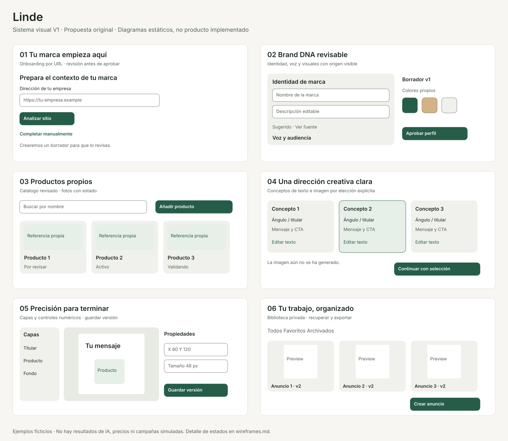
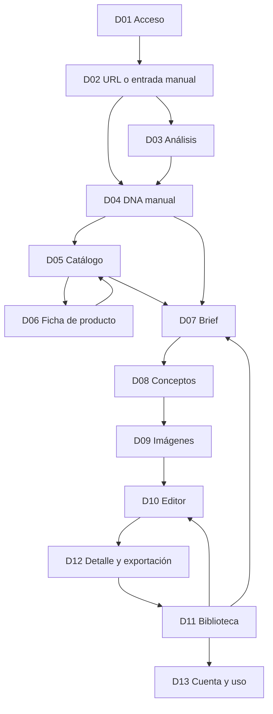

# Linde — sistema visual y experiencia V1

Propuesta de Design para aprobación · 2026-10-26 · America/Mexico_City.

**Linde es un nombre de trabajo**, no una marca registrada ni un nombre comercial validado. Se propone una identidad editorial cálida, precisa y tranquila para crear anuncios de una marca. No se copiaron colores, pantallas, logos, fuentes, imágenes, iconos o copys de Holo. La arquitectura aprobada permanece intacta. Todo lo descrito es diseño de nuestra alternativa, no observación de su interfaz.

## Entregables y recorrido de revisión

1. Este documento: dirección visual, navegación y responsive.
2. [Tokens JSON](tokens.json), [variables CSS de referencia](tokens.css) y [mapeo Tailwind](tailwind-mapping.md).
3. [Componentes e interacción](components.md).
4. [Pantallas y contratos](screens.md).
5. [Wireframes desktop, móvil y estados](wireframes.md).
6. [Editor: precisión y accesibilidad](editor.md).
7. [Accesibilidad y validación](accessibility.md), [contraste medido](contrast-report.md).
8. Láminas originales: [seis módulos](boards/modules.svg), [editor desktop](boards/editor-desktop.svg) y [editor móvil](boards/editor-mobile.svg). Son diagramas estáticos, no una app o prototipo funcional; el detalle contractual está en los documentos.

Referencias aprobadas leídas completas: [Recon](../recon.md), [73 funcionalidades](../features.csv), [arquitectura](../architecture.md), [datos](../data-model.md), [API y jobs](../api-and-jobs.md) e [IA/costes/seguridad](../ai-costs-security.md). Se aplicó `.agents/skills/replica-design/SKILL.md` y su comprobador de contraste. No existen screenshots de referencia en `replica/screens/`; por ello no se atribuyen medidas ni colores a Holo. Las medidas aquí son **decisiones originales**.

La skill propone construir primitivas y una ruta de muestra; se omite ese paso porque el usuario ha pedido solo documentación y no avanzar a Build. CSS y JSON son especificaciones declarativas de tokens, sin componentes, estilos de pantallas, configuraciones de aplicación o dependencias instaladas. No se ejecuta ningún despliegue ni se crean servicios.

Las láminas son esquemas de revisión, no medidas de implementación ni pruebas de UI: dimensiones de controles y tipografía finales se rigen por tokens y componentes. Los SVG usan Inter si está disponible y fallback local; las previews raster de inspección usan fuente de sustitución y no validan métricas exactas de Inter.

## 1. Dirección visual

Idea: **un taller editorial para decisiones creativas claras**. Fondos marfil suaves, superficies blancas y verdes profundos; negro suavizado para lectura, contraste suficiente y bordes definidos en controles. Espacio generoso alrededor de decisiones; densidad mayor en catálogo/editor donde ayuda al trabajo. Cero paneles de métricas ficticias o gráficas decorativas. El contenido del usuario es protagonista.

| Principio | Traducción concreta |
| --- | --- |
| Jerarquía tranquila | Un título y una acción primaria por contexto; secundarios de menor peso; 16 px de cuerpo |
| Claridad | Etiquetas persistentes, verbos concretos, costes antes de generar, estados distinguibles |
| Continuidad | Misma marca visible; producto y perfil seleccionado acompañan el flujo; volver conserva valores |
| Control | Revisar antes de aprobar/gastar; guardar/exportar sin regenerar IA; cambios reversibles |
| Precisión | Geometría numérica y tipografía estable; sin animaciones elásticas que desplacen controles |
| Honestidad | Campo inferido con fuente y aviso de revisión; no porcentajes de progreso o tiempos inventados |

La referencia a Apple se aplica a jerarquía, legibilidad, adaptación y consistencia, **no a copiar su identidad, SF Pro, iconografía, materiales o layouts**. No se usan marcas Apple, ilustraciones propietarias, efecto de vidrio generalizado ni UI que pretenda ser nativa de macOS. Las convenciones SaaS adoptadas (sidebar, formularios, breadcrumbs, inspector) son patrones funcionales propios, no reproducciones de un producto específico.

### Identidad y recursos

Wordmark tipográfico “Linde” en Inter 600, sin símbolo copiado. No se entrega un logo definitivo ni se hace búsqueda de marcas/dominio. La identidad puede cambiar el nombre sin alterar tokens semánticos. Inter se propone por legibilidad y cobertura de español; verificar licencia del archivo exacto antes de empaquetar. UI 400/500/600, evitando mayúsculas largas y tracking excesivo. Fallback `system-ui, sans-serif`; no distribuir fuentes del sistema.

Iconos: set abierto propuesto Lucide, 20 px de dibujo sobre área 44×44; verificar licencia/versión antes de Build. Solo se especifican nombres/funciones, no se descargan recursos. Iconos de estado siempre con texto. Imágenes de ejemplos: bloques abstractos originales rotulados “Referencia”; no simulan generaciones, logos de clientes, rendimiento o testimonios. Nunca introducir recursos de Holo.

Tema V1 claro únicamente; no botón dark que no funcione. El fondo de lienzo es neutral para juzgar el anuncio. Los colores del Brand DNA se aplican al creativo, **no cambian la identidad ni el contraste de la app**.

## 2. Navegación e información

Sidebar desktop con wordmark, nombre de marca actual (informativo, no switcher multimarcas), y cuatro destinos: **Crear anuncio**, **Brand DNA**, **Productos**, **Biblioteca**. Cuenta y uso al pie. El onboarding vive fuera del shell hasta guardar perfil/producto mínimo; no bloquea revisar la marca después. “Crear anuncio” resalta mientras se recorren brief → conceptos → imagen; el editor usa shell de trabajo aparte y botón “Volver a Biblioteca”.

No mostrar Video, UGC, redes, calendarios, equipos o integraciones como pestañas deshabilitadas. Son alcance futuro aprobado solo como extensión técnica, no UI V1. No dashboard con analytics o chat general. La entrada posterior al alta lleva a Biblioteca si hay creativos, o Crear anuncio si aún no los hay. Un banner contextual puede enlazar a terminar DNA/producto, sin inventar una pantalla Home.

Ruta crítica: URL → análisis → revisar/aprobar DNA → revisar/crear producto activo con imagen ready → brief → tres conceptos → imagen elegida → texto/composición → guardar → exportar PNG. Los conceptos nunca generan tres imágenes automáticamente. Si el usuario decide generar hasta tres, confirma número y presupuesto; cada trabajo tiene estado/cancelación independiente.

Guardado explícito de formularios y editor; no prometer autosave que no esté implementado. En navegación interna con cambios no guardados: Guardar y salir / Seguir editando / Descartar. Un draft del editor puede ser local transitorio como recuperación propuesta, pero no se le llama “guardado” ni es la única persistencia; la versión de DB manda. Cerrar navegador puede disparar diálogo nativo, sin promesa de texto propio. No enviar trabajos duplicados al refrescar.

## 3. Layout y responsive

| Ancho CSS | Shell y contenido | Editor |
| --- | --- | --- |
| 1280+ | Sidebar 224; header 64; padding 32; contenido máx. 1280; formularios máx. 640 | Tres regiones: capas 240 + lienzo flexible + inspector 288; header 64, toolbar 48, footer 40 |
| 1024–1279 | Sidebar 224; contenido restante; tarjetas 2 columnas; padding 32 | Inspector 288 persistente, capas en drawer; lienzo mínimo útil 320, nunca encoger controles |
| 640–1023 | Sidebar se convierte en menú modal; header 64; padding 24; tarjetas 2 columnas si caben con mínimo 240 | Lienzo en página; tabs Capas/Propiedades abren panel a ancho disponible; una región de control visible por vez |
| 320–639 | Header marca + menú 64; padding 16; una columna, formularios sin ancho mínimo | Lienzo ajustado al ancho; panel de propiedades debajo, no encima; toolbar a filas; acciones en flujo al abrir teclado |

Desktop de revisión: 1440×1000; compacto: 390×844 y 320×568. A 200% texto y 400% zoom, la UI refluye con las mismas reglas, sin depender del dispositivo. No ocultar funciones en móvil: transformaciones numéricas, edición textual, orden de capas y exportar siguen disponibles. El lienzo es una región visual 2D con zoom/pan intencionados; formularios, diálogos y navegación no requieren scroll horizontal. Ver accesibilidad para alternativa DOM del lienzo.

Espaciado base de 4 px; cadencia de contenido 8/16/24/32. Tipos, layout, radios y duraciones exactos en tokens. Titulares 28/36 desktop, 20/28 compacto; display 40/48 solo bienvenida, 28/36 compacto. Inputs y acciones principales 44 px; compactos 36 solo donde el área activa y separación satisfagan el mínimo, 44 en táctil. Cuerpo 16; metadatos 14; 12 solo timestamps o ayudas secundarias no esenciales.

Card: blanco, borde decorativo, radio 16, sombra mínima. El borde tenue **no identifica campos**; inputs y controles usan border-input con contraste probado. Encabezados sticky solo cuando no ocultan foco; safe area y scroll-padding reservan espacio. Ninguna acción depende solo de hover. Menú del shell y formularios mantienen posición lógica y foco al cambiar breakpoint; no renderizar dos controles duplicados accesibles.

## 4. Motion y contenido

120 ms para hover/focus, 180 ms popover, 240 ms drawer como máximo; ease definido en tokens. Animar opacidad/transform únicamente para elementos secundarios; nada de parallax, looping publicitario o resorte en lienzo. No animar geometría del anuncio al guardarla. `prefers-reduced-motion`: cambios instantáneos, spinner sustituido por texto y estado; no pulsación permanente. Loading no implica una duración prometida.

Voz en español: directa, sin tecnicismos internos. “Revisar información”, “Aprobar perfil”, “Crear 3 conceptos”, “Generar 1 imagen”, “Guardar versión”, “Exportar PNG”. Evitar “Lanzar campaña” o “Publicar” en V1. “Estimación máxima: {importe} {moneda}” solo si el backend dispone de cota válida. Si no, “La generación no está disponible todavía” + explicación relevante para decidir; no mostrar claves, modelos internos o paneles de infraestructura al usuario.

Tiempo en zona local del usuario, fecha absoluta en detalle accesible; la DB conserva UTC. Estado “Se guardó a las 10:42” solo tras confirmación del servidor, nunca al iniciar request. Nombres largos de marca/producto se parten; truncamiento visual tiene nombre completo accesible sin requerir tooltip.

## 5. Comprobaciones y límites

Objetivo WCAG 2.2 AA, no certificación. Contraste calculado para 58 pares permitidos: [reporte](contrast-report.md). Wireframes e inventario cubren 13 superficies D01–D13; D son nuestras especificaciones y S son referencias de Recon, no rutas copiadas. Los mocks estáticos no verifican teclado, lectores, zoom, render o fidelidad; checklist obligatorio antes de aceptar Build.

Fuentes de principios consultadas en esta fase (2026-10-26): [WCAG 2.2](https://www.w3.org/TR/WCAG22/), [WAI: Dragging Movements](https://www.w3.org/WAI/WCAG22/Understanding/dragging-movements.html), [Apple HIG Markdown](https://developer.apple.com/design/human-interface-guidelines.md). Apple HIG se usó como referencia conceptual pública de tipografía/layout/accesibilidad; no se evaluaron interfaces de Apple ni se extrajeron recursos.

Pendiente aprobación: dirección visual, seis módulos, navegación, editor y alcance responsive. No se solicitan credenciales ni servicios. No se avanza a Build por publicar esta propuesta.
